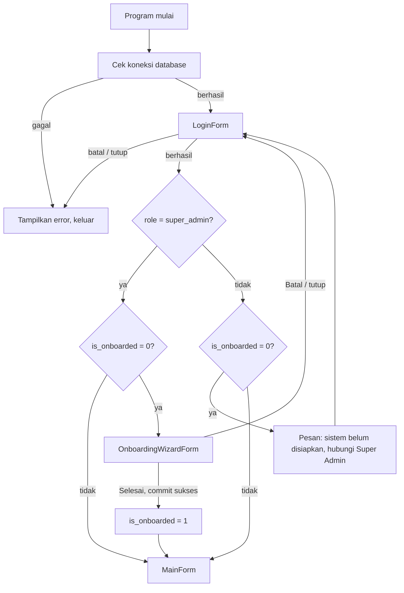
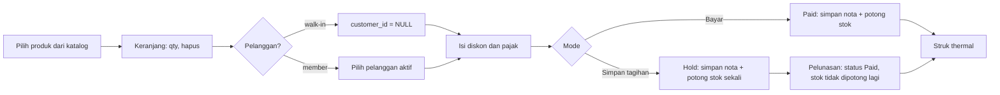

# Alur Pengguna & User Story

Dokumen ini menjawab pertanyaan "layar ini isinya apa dan urutannya bagaimana". Aturan bisnis umum tetap di `06-SPESIFIKASI.md`; cara teknis ada di `04-ARSITEKTUR.md` dan `05-UI-SHELL.md`.

Cara pakai:

- Owner halaman memakai tabel field dan urutan langkah di sini sebagai daftar kerja. Tidak perlu menebak field tambahan.
- Kalau dokumen ini berbeda dengan `06-SPESIFIKASI.md` soal aturan bisnis, `06` menang dan dokumen ini diperbaiki.
- Perubahan field atau urutan langkah wajib memperbarui dokumen ini dan `02-TASKS.md` pada commit yang sama.

---

## 1. Alur Masuk Aplikasi

Urutan gate ditentukan sekali di `Program.cs` (file shared, koordinasi Moreno):



Aturan:

1. Cek koneksi tetap seperti sekarang; aplikasi berhenti kalau database tidak terjangkau.
2. Wizard hanya untuk `super_admin`. Peran lain yang login saat `is_onboarded = 0` melihat pesan dan kembali ke login, bukan diarahkan ke wizard.
3. Wizard adalah Form modal, bukan `UserControl`. Batal atau tombol tutup tidak menulis apa pun dan mengembalikan pengguna ke login.
4. Setelah wizard selesai, `Program` membuat `MainForm` baru sehingga `app_config` dibaca ulang. Tidak perlu restart aplikasi.
5. `Program.cs` tidak membaca `app_config` langsung. Tambahkan method baca di `PengaturanService` (contoh `AmbilIsOnboarded()`), bukan query di `Program`.

---

## 2. Onboarding: 4 Halaman

Jumlah halaman mengikuti proposal: **empat**, tanpa halaman sambutan terpisah. Satu `OnboardingWizardForm` dengan panel per langkah, indikator "Langkah n dari 4", tombol **Batal**, **Kembali**, dan **Lanjut**/**Selesai**.

Gambar tata letak tiap langkah ada di `08-MOCKUP-HALAMAN.md` §3.2 (ASCII, kontrol Windows Forms). Itu acuan susunan kontrol, bukan file Designer final: jarak boleh disesuaikan saat implementasi, field dan urutan tidak.

Aturan global:

- **Tidak ada penulisan database sebelum tombol Selesai.** Semua isian disimpan di memori form. Ini mencegah toko setengah terkonfigurasi kalau pengguna berhenti di tengah.
- Validasi dilakukan per halaman saat **Lanjut**. Halaman yang gagal validasi tidak berpindah.
- **Kembali** mempertahankan isian yang sudah diisi.
- **Selesai** hanya aktif di halaman 4 dan hanya berjalan setelah validasi halaman 4 lulus.
- Semua penulisan Selesai memakai satu `MySqlTransaction`. Gagal di langkah mana pun berarti rollback dan pengguna tetap di halaman 4.

### Halaman 1 — Identitas Usaha

Tata letak: `08-MOCKUP-HALAMAN.md` §3.2, langkah 1.

| Field | Kunci `app_config` | Wajib | Aturan |
| :--- | :--- | :---: | :--- |
| Nama usaha | `business_name` | Ya | 3–100 karakter; dipakai di header, struk, laporan |
| Alamat | `business_address` | Ya | 5–255 karakter; multiline |
| Telepon | `business_phone` | Ya | 6–20 karakter; angka, spasi, `+`, `-`, `(`, `)` |

### Halaman 2 — Model Bisnis

Tata letak: `08-MOCKUP-HALAMAN.md` §3.2, langkah 2.

| Field | Kunci `app_config` | Wajib | Aturan |
| :--- | :--- | :---: | :--- |
| Retail | `enable_retail` | Salah satu | Checkbox; `1` kalau dicentang |
| F&B | `enable_fnb` | Salah satu | Checkbox; `1` kalau dicentang |
| Jasa | `enable_service` | Salah satu | Checkbox; `1` kalau dicentang |

- Minimal satu checkbox dicentang. Tidak ada kombinasi "kosong semua".
- Ketiga flag ditulis apa adanya (`0`/`1`) saat Selesai.
- Halaman 3 menyesuaikan pilihan F&B dari halaman ini.
- Kalau F&B dimatikan, checkbox Resep di halaman 3 dinonaktifkan dan disimpan sebagai `0`; saat F&B dinyalakan lagi, nilainya kembali ke pilihan terakhir pengguna (default tercentang).

### Halaman 3 — Mesin & Operasional

Tata letak: `08-MOCKUP-HALAMAN.md` §3.2, langkah 3.

| Field | Kunci `app_config` | Wajib | Aturan |
| :--- | :--- | :---: | :--- |
| Resep & HPP | `enable_recipe_bom` | Tidak | Hanya aktif kalau F&B dicentang; default tercentang saat F&B aktif; dipaksa `0` kalau F&B tidak aktif |
| Wajib buka shift | `enable_shift` | Tidak | Checkbox; default tercentang |
| Multi-cabang | `enable_multi_branch` | Tidak | Checkbox; default tercentang; menyalakan menu Transfer Stok dan filter cabang |
| Pajak default | `tax_percentage` | Ya | 0–100, maksimal 2 desimal; default `10`; disimpan dengan titik desimal (`10`, `10.5`) |

Catatan `enable_multi_branch`: flag ini sudah ada di `06-SPESIFIKASI.md` §9.1 dan dipakai shell, tetapi tidak disebut di tabel empat tahap proposal. Penempatannya di halaman 3 dicatat sebagai keputusan teknis setelah approval, bukan perubahan proposal.

### Halaman 4 — Cabang & Akun

Tata letak: `08-MOCKUP-HALAMAN.md` §3.2, langkah 4.

| Field | Tabel | Wajib | Aturan |
| :--- | :--- | :---: | :--- |
| Nama cabang | `branches.nama_cabang` | Ya | 3–100 karakter; prefill nama usaha, boleh diubah |
| Alamat cabang | `branches.alamat` | Ya | Prefill alamat usaha, boleh diubah |
| Telepon cabang | `branches.no_telp` | Ya | Prefill telepon usaha, boleh diubah |
| Username admin | `users.username` | Ya | 4–50 karakter; huruf kecil, angka, titik, garis bawah, strip; unik kecuali akun sendiri; prefill `admin` |
| Nama lengkap admin | `users.nama_lengkap` | Ya | 3–100 karakter; prefill `Super Administrator` |
| Password | `users.password_hash` | Ya | Minimal 6 karakter; disimpan SHA-256, bukan teks biasa |
| Konfirmasi password | — | Ya | Harus sama dengan password |

Prefill tiga field cabang dilakukan **sekali**, saat halaman 4 pertama kali dibuka. Kalau pengguna kembali ke halaman 1 lalu mengubah identitas usaha, isian cabang yang sudah disunting tidak ditimpa.

Cara menulis data:

1. **Cabang pusat** memakai baris `branches.id = 1` yang sudah di-seed. Kalau baris itu tidak ada, insert baru. Setelah itu `is_pusat = 1`.
2. **Akun admin** memakai baris `users.id = 1` yang sudah di-seed. Update `username`, `nama_lengkap`, `password_hash`, `branch_id = id cabang pusat`, `role = 'super_admin'`, `is_active = 1`. Kalau baris itu tidak ada, insert baru.
3. Username yang dipakai akun lain ditolak dengan pesan jelas; jangan menimpa akun orang lain.
4. `is_onboarded = 1` ditulis **paling akhir**, setelah identitas, flag, cabang, dan akun berhasil. Kalau penulisan ini gagal, seluruh transaksi rollback.
5. Urutan tulis: `app_config` (semua kunci halaman 1–3) → `branches` → `users` → `is_onboarded`.

### Yang Tidak Ada di Wizard

Jangan menambah field berikut ke onboarding. Semuanya punya menu sendiri setelah login:

| Data | Tempat yang benar |
| :--- | :--- |
| Pelanggan/member | `UcPelanggan` (T-15) |
| Produk, kategori, layanan | `UcMasterProduk` / `UcKategori` (T-13) |
| Bahan baku, resep, HPP | `UcBahanBaku` / `UcResepBOM` (T-14) |
| Pengguna selain admin pertama | `UcPengaturanPengguna` (T-18) |
| Cabang tambahan | `UcPengaturanPengguna` / `UcPengaturanToko` (T-18) |
| Logo, footer struk, format nomor nota | Belum diminta spec; jangan dikarang |

---

## 3. Field Pelanggan: Di Mana Saja

Pelanggan **bukan** bagian onboarding. Data pelanggan dikelola di satu halaman (`UcPelanggan`) dan hanya dipakai sebagai pilihan opsional di kasir.

| Field | `customers` | Tampil di `UcPelanggan` | Tampil di `UcKasir` |
| :--- | :--- | :---: | :---: |
| Nama | `nama` | Ya, wajib | Ya, untuk pencarian/pilihan |
| Telepon | `no_telp` | Ya, opsional | Ya, untuk pencarian |
| Email | `email` | Ya, opsional; validasi format kalau diisi | Tidak |
| Poin | `poin` | Ya, angka ≥ 0 | Ditampilkan pada pelanggan terpilih |
| Status aktif | `is_active` | Ya, checkbox | Hanya pelanggan aktif yang muncul |
| Cabang | `branch_id` | Otomatis untuk BM/Kasir; pilihan untuk SA | Mengikuti cabang pengguna |

Aturan:

1. **Walk-in adalah default.** Tanpa pelanggan, transaksi tetap bisa dibayar dan `customer_id` bernilai `NULL`.
2. Kasir memilih pelanggan lewat pencarian nama/telepon. **Tidak ada tombol tambah pelanggan cepat di kasir**; pembuatan data tetap di `UcPelanggan` agar tidak ada dua jalur input.
3. `label_meja_pelanggan` adalah teks bebas: nomor meja (F&B), nomor antrean/plat kendaraan (Jasa), atau nama tamu. Field ini terpisah dari pelanggan dan tidak wajib.
4. Pelanggan nonaktif tidak muncul di kasir. Menghapus pelanggan memakai `is_active = 0` sebagai pilihan utama; hard delete tetap aman karena FK `ON DELETE SET NULL`.
5. **Poin tidak bertambah otomatis.** Belum ada aturan perolehan/penukaran poin di spec. `poin` hanya bisa diubah manual oleh SA/BM di `UcPelanggan`; kasir menampilkannya sebagai informasi. Jangan mengarang rumus poin.
6. Laporan penjualan menampilkan nama pelanggan, atau `-`/`Umum` kalau walk-in.

---

## 4. Alur Kasir

### 4.1 Checkout: Walk-in, Member, dan Hold



Field yang ada di `UcKasir`:

| Field | Wajib | Aturan |
| :--- | :---: | :--- |
| Pencarian/katalog produk | — | Hanya produk aktif di cabang pengguna |
| Keranjang | Ya | Minimal 1 item; qty ≥ 1; harga satuan dari master |
| Pelanggan | Tidak | Default walk-in; hanya pelanggan aktif |
| Label meja/pelanggan | Tidak | Teks bebas, maksimal 100 karakter |
| Diskon | Tidak | Nominal rupiah, bukan persen; 0 ≤ diskon ≤ subtotal |
| Pajak | Tidak | Persen; prefill `tax_percentage`; boleh diubah untuk nota ini |
| Metode bayar | Ya | Satu pilihan: tunai, QRIS, atau transfer |
| Uang bayar | Tunai | Wajib; harus ≥ total akhir |
| Kembalian | — | Dihitung sistem, bukan input |

Aturan transaksi:

- **Satu nota satu metode bayar.** Pembayaran terbelah belum didukung.
- `pajak = (subtotal - diskon) × tax_percentage / 100`, dibulatkan 2 desimal pada nilai yang disimpan.
- QRIS/transfer: `uang_bayar = total_akhir`, `kembalian = 0`.
- Nota, detail, mutasi stok, dan perubahan stok ditulis dalam satu `MySqlTransaction`.
- **Hold memotong stok saat nota dibuat.** Pelunasan hanya mengubah `status` menjadi `paid` dan mengisi pembayaran; stok tidak dipotong lagi. Void mengembalikan stok sekali dan menulis mutasi `void`.
- Void tidak menghapus baris. Status berubah menjadi `void`; struk lama tetap bisa dicetak ulang.
- Nomor nota: `INV-<branch_id 2 digit>-<yyyyMMdd>-<urut 4 digit>`, contoh `INV-01-20261120-0001`. Urutan dihitung per cabang per hari di dalam transaksi.
- Kalau `enable_shift = 1`, tombol Bayar ditolak sampai pengguna punya shift `open`. Pesan mengarahkan ke menu Shift Kasir.

### 4.2 Buka dan Tutup Shift

1. Buka: pilih cabang (SA) atau pakai cabang sendiri (BM/Kasir), isi `modal_awal`, sistem membuat baris `shifts` dengan `status = open`.
2. Satu pengguna hanya boleh punya satu shift `open`. Percobaan kedua ditolak.
3. Tutup (*blind close*): kasir mengisi `uang_fisik` tanpa melihat `uang_sistem` lebih dulu.
4. Sistem menghitung `uang_sistem = modal_awal + total pembayaran tunai pada shift itu`, lalu `selisih = uang_fisik - uang_sistem`.
5. Simpan `waktu_tutup`, `uang_sistem`, `uang_fisik`, `selisih`, `status = closed`.
6. QRIS/transfer tidak masuk `uang_sistem` tunai; tampilkan terpisah di rekap.

### 4.3 Antrean Servis

- Transaksi yang memuat produk/layanan jasa membuat **satu** baris `service_jobs` (UNIQUE `transaction_id`).
- Nomor antrean dibuat otomatis per cabang per hari: `S-001`, `S-002`, dst.
- Status: `antri` → `dikerjakan` → `selesai` → `diambil`. `batal` boleh dari `antri` atau `dikerjakan`.
- Teknisi opsional; pilihan berasal dari pengguna aktif di cabang yang sama.
- Layanan jasa tidak memotong stok barang. Kalau transaksi juga memuat produk fisik, produk itu tetap memotong stok lewat aturan normal.
- Membatalkan pekerjaan **tidak otomatis** mem-void nota. Kalau nota sudah dibayar, kasir mem-void nota lewat alur kasir; dua aksi ini terpisah dan sama-sama tercatat.

---

## 5. User Story dan Kriteria Penerimaan

| ID | User story | Kriteria penerimaan |
| :--- | :--- | :--- |
| US-01 | Sebagai Super Admin, saya ingin menyiapkan toko lewat wizard agar aplikasi siap dipakai tanpa edit database. | Empat halaman berurutan; tidak ada tulisan DB sebelum Selesai; commit sukses menulis semua kunci, cabang pusat, akun admin, lalu `is_onboarded=1`; Batal tidak mengubah data. |
| US-02 | Sebagai pengguna non-admin, saya tidak boleh masuk ke shell sebelum toko disiapkan. | Login saat `is_onboarded=0` menampilkan pesan dan kembali ke login; tidak ada menu yang bisa dibuka. |
| US-03 | Sebagai kasir, saya ingin melayani pembeli walk-in secepat mungkin. | Tanpa memilih pelanggan, nota bisa dibayar; `customer_id` NULL; stok terpotong; struk tercetak; laporan menampilkan `Umum`. |
| US-04 | Sebagai kasir, saya ingin mengaitkan nota ke member tanpa mengganggu alur walk-in. | Pencarian pelanggan aktif berfungsi; pelanggan nonaktif tidak muncul; nota menyimpan `customer_id`; transaksi tanpa member tetap valid. |
| US-05 | Sebagai kasir F&B, saya ingin menyimpan tagihan meja lalu melunasinya nanti. | Hold menyimpan nota dan memotong stok sekali; pelunasan mengubah status ke paid tanpa mutasi stok baru; void mengembalikan stok sekali. |
| US-06 | Sebagai kasir, saya ingin membuka dan menutup shift agar kas fisik cocok dengan sistem. | Satu shift aktif per pengguna; tutup shift menghitung sistem dari modal + tunai; selisih tampil dan tersimpan. |
| US-07 | Sebagai kasir jasa, saya ingin mencatat antrean pekerjaan dan statusnya. | Satu job per transaksi jasa; nomor antrean unik per cabang per hari; status berpindah sesuai urutan; layanan tidak memotong stok. |
| US-08 | Sebagai pemilik toko, saya ingin menu mengikuti model bisnis yang dipilih saat onboarding. | Mematikan F&B menyembunyikan Bahan Baku/Resep; mematikan Jasa menyembunyikan Antrean Servis; mematikan shift menyembunyikan Shift Kasir; perubahan berlaku setelah login berikutnya. |

---

## 6. Keputusan yang Dikunci

Keputusan berikut diambil agar owner tidak menebak. Kalau berubah, ubah bagian ini dan `06-SPESIFIKASI.md` pada commit yang sama.

1. **Onboarding empat halaman tanpa halaman sambutan.** Isi field mengikuti proposal; `enable_multi_branch` ditempatkan di halaman 3.
2. **Tidak ada penulisan DB per halaman.** Hanya Selesai yang menulis, dalam satu transaksi.
3. **Wizard hanya untuk Super Admin.** Peran lain ditolak dengan pesan.
4. **Akun admin pertama memakai baris seed `users.id = 1`.** Tidak membuat akun super admin kedua.
5. **Pelanggan tidak ada di onboarding dan tidak bisa ditambah dari kasir.**
6. **Poin tidak bertambah otomatis.** Belum ada aturan loyalitas di spec.
7. **Diskon berupa nominal rupiah, bukan persen.**
8. **Hold memotong stok saat dibuat; pelunasan tidak memotong ulang.**
9. **Shift diwajibkan untuk semua pengguna yang bertransaksi saat `enable_shift=1`.**
10. **Nomor nota dan nomor antrean memakai format di §4.1 dan §4.3.**

---

## 7. Reset untuk Demo

`seed_demo.sql` sengaja tidak mengubah `is_onboarded`; nilai dari `schema_pos.sql` tetap `0`, sehingga wizard bisa didemokan. Setelah wizard dijalankan sekali, reset dengan:

```sql
UPDATE app_config SET setting_value = '0' WHERE setting_key = 'is_onboarded';
```

Jalankan reset hanya di database demo, bukan database yang sudah dipakai.
